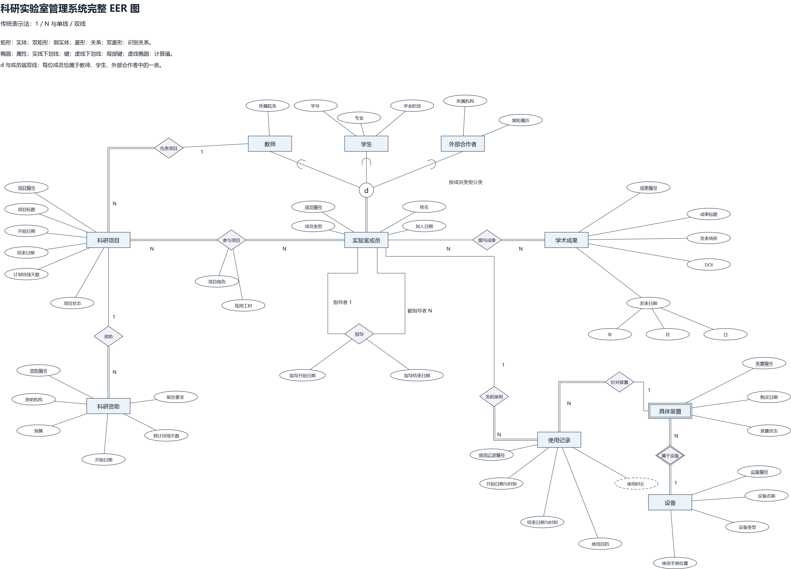
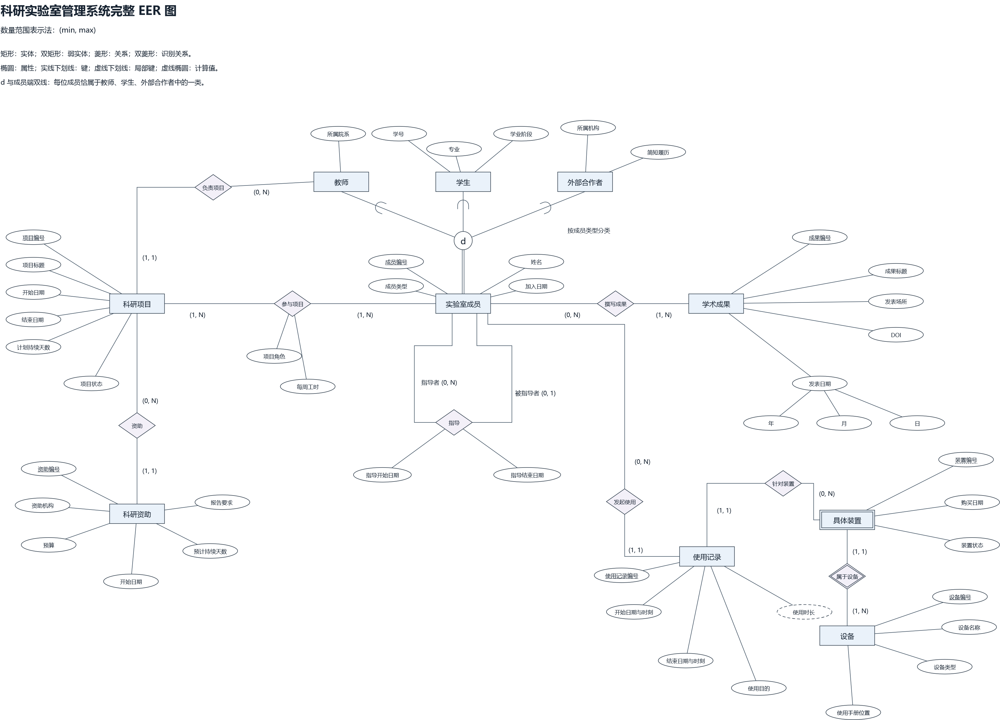

# 科研实验室管理系统概念结构设计报告

## 1 本阶段目标

本阶段我们对科研实验室管理系统作了需求分析，并建立了可以继续实现的概念模式。实体、联系和属性使用教材第 3 章的实体—联系记号，成员的类与子类层次使用第 4 章的特化与泛化记号。图中标出了键属性，递归联系的两端标出了角色，结构约束同时用传统的基数比、单线与双线以及 (min, max) 表示。需求说明没有写明、却影响基数或参与约束的决定，列入第 5 节。必须遵守但无法直接画进 EER 图的条件，包括附加键，列入第 6 节。设计理由和本阶段遇到的困难分别写在第 4 节和第 7 节，供后续落实逻辑模式和应用程序时参考。

概念模式规定系统要保存哪些事实，以及这些事实之间至少有怎样的数量关系。表的划分、索引和操作界面不在本阶段决定。查询、更新和报表所需的数据已经包含在当前的实体、属性和联系之中；这些功能留到后续阶段实现。

## 2 应用需求分析

本系统用于支持大学科研实验室的日常管理，需要跟踪成员、科研项目、设备使用、学术成果，以及由科研资助提供的经费。成员包括教师、学生和外部合作者。每位成员参加项目，可以使用实验室的共享设备，也可以参与撰写学术成果。项目由教师负责，并由资助提供经费；资助带有预算和报告要求。实验室还在成员之间维持指导关系。系统只管理与这些科研活动直接相关的人和事，不包括课程选修、财务报销或学校人事系统的全部信息。

成员由成员编号识别，并记录姓名、成员类型和加入日期。成员类型把人员分成教师、学生和外部合作者，而且一名成员只能属于其中一类。三类人员需要保存的附加信息不同。教师要记录所在院系。学生要记录学号、学业阶段和专业；学业阶段包括低年级、高年级和研究生等情形，需求说明没有给出封闭的取值表。外部合作者要记录所属机构和一份简短履历。姓名、院系、专业、机构和履历都是描述信息，需求说明未要求它们全局唯一。

科研项目由唯一的项目编号识别，并记录标题、开始日期、结束日期、计划持续时间和状态。状态取进行中、已完成或已暂停。每位实验室成员至少参加一个项目；在某一个具体项目中，系统要记下该成员的角色和每周投入工时。角色和工时依附于“哪个成员参加哪个项目”，同一个人参加不同项目时可以不同。教师可以负责多个项目，每个项目恰好有一位负责人。需求说明没有写明这位负责人是否必须同时出现在该项目的参与记录中，也没有写明一个项目在负责人之外是否还需要其他参与者。这一点会改变“项目至少有多少名参与者”，因此我们把它写入第 5 节的假设。

科研资助由唯一编号识别，并记录资助机构、预算、开始日期、预计持续时间和报告要求。每一项资助只用于资助一个项目，有些项目可以没有任何资助。需求说明没有规定一个项目至多只能获得一项资助，因此资助端与项目一一对应，项目端则可以对应零项或多项资助。预算和持续时间的计量单位，以及它们能否为零，需求说明没有给出，我们在假设中作了补充。

设备由唯一的设备编号识别，并记录名称、类型和手册。这里的“设备”表示一种仪器或一类装置的说明，真正被成员使用的是它的实物单元。每种设备至少有一个具体装置。每个装置记录购买日期、状态和装置编号；状态取可用、使用中或已退役。装置编号只在所属设备内部唯一，不同设备下的装置可以共用同一个装置编号。因此，单靠装置编号不能在整个实验室里确定一台实物。成员使用装置时，系统必须记录使用的开始日期、结束日期和使用目的。同一装置不能同时被超过三名成员使用。这句话限制的是同一时刻重叠的使用，不是这台装置从购入到退役一共只能留下三条使用记录。

学术成果由唯一编号识别，并记录标题、发表日期、发表场所和可选的 DOI。发表日期至少包含年份和月份。每一项成果至少由一位实验室成员撰写，通常由多位成员合作完成。需求说明没有要求成果必须隶属于某个项目，也没有要求记录实验室以外的作者，因此概念模式只保存实验室成员与成果之间的撰写关系。

指导发生在成员与成员之间。每一段指导要记录开始日期和结束日期。一名被指导者不能有超过一位指导者，学生不能指导教师。需求说明没有写明成员能否指导自己，也没有写明一段指导结束后，被指导者能否再接受另一位指导者并保留过去的记录。若把“不能有超过一位指导者”理解为全部历史记录中至多一位，现在的递归联系就能够表达；若只理解为任意时刻至多一位，就需要另行保存历史。本组暂按全部已保存记录中至多一位来设计，并在第 5 节标明这一理解仍待确认。

有些条件依赖时间比较、两个联系之间的对照或取值范围，不能直接画进 E/R 图。成员、项目、资助、设备、使用、成果和指导已经保存了编制名单、统计工时、查看装置占用和汇总成果所需的数据，后续的查询、更新和报表可以据此实现。不能直接画入图中的规则在第 6 节列出，留待逻辑设计和应用程序中检查。

需求说明中还有一些未写明的细节。凡是改变了连线上的最小数量、为实体增加了需求中没有的识别号，或规定了空值与取值范围的地方，我们都在第 5 节写出。这些假设用于完成概念设计，并且不与已给条件冲突。

## 3 概念模式

概念模式画成两张扩展实体—联系图。图 1 使用传统记号，用 1 与 N 表示基数比，用单线与双线表示部分参与和完全参与。图 2 使用 (min, max) 记号，在每个实体参加联系的一端直接写出该实体可以参与的最少次数和最多次数。两张图的实体、属性、联系、特化层次和键完全相同，不同的只是结构约束的标法。两张图用 diagrams.net 绘制，绘图文件见附图。

图 1 科研实验室管理系统扩展实体—联系图（传统表示法）

图 2 科研实验室管理系统扩展实体—联系图（(min, max) 表示法）

### 3.1 记号与两种数量标法

矩形表示实体类型，双矩形表示弱实体类型。菱形表示联系类型，双菱形表示弱实体的识别联系。椭圆表示属性。实线下划线表示实体的键，虚线下划线表示弱实体的局部键，虚线椭圆表示由其他属性计算得到的派生属性。成员分类使用第 4 章的记号：圆圈中的 d 表示子类互斥，成员与圆圈之间的双线表示特化是完全的，圆圈通向教师、学生和外部合作者的连线上各有一个半圆形的子集符号，表示相应子类是实验室成员的子集。圆圈旁的“按成员类型分类”标明这次特化由属性“成员类型”定义。

读传统图时，标在某一端的 1 或 N 表示这一端的一个实体可以与另一端的多少个实体相关联，双线表示该实体类型的每一个实例都必须参加这个联系，单线表示可以不参加。读 (min, max) 图时，写在某一端的数表示这一个实体自己参加该联系的最少次数和最多次数。两种记号因此不会把同一个数字标在同一端。以“负责项目”为例，传统图在教师端标 1、在项目端标 N，并且只在项目端使用双线；图 2 在教师端写 (0, N)、在项目端写 (1, 1)。它们表达的是同一条业务规则：每个项目恰好由一位教师负责，一位教师可以负责多个项目，也可以暂时不负责任何项目。其余联系也按这个读法绘制，两种图上的数字并不标在同一端。

图 2 的普通联系不再另画单线和双线，因为 (min, max) 的下界已经表示是否必须参加。成员连向特化圆圈的双线在两张图上都保留，因为它表示的是特化的完全性，不是某一个二元联系的基数。

### 3.2 实体、特化与属性

模式中的实体类型包括实验室成员、教师、学生、外部合作者、科研项目、科研资助、学术成果、使用记录、设备和具体装置。教师、学生和外部合作者是实验室成员的三个子类。由于分类互斥而且完全，每一名成员在任一时刻恰好进入其中一个子类，不能同时属于两类，也不能停留在超类之外。子类继承超类的成员编号、姓名、成员类型和加入日期。教师另外记录所属院系，学生另外记录学号、学业阶段和专业，外部合作者另外记录所属机构和简短履历。成员编号是实验室成员的键，也是三个子类继承来的识别依据。学号画在学生子类上，但没有使用主键的实线下划线。成员编号仍是学生的识别依据，学号作为候选键，其唯一性范围在第 6 节说明。

科研项目以项目编号为键，并保存项目标题、开始日期、结束日期、计划持续天数和项目状态。科研资助以资助编号为键，并保存资助机构、预算、开始日期、预计持续天数和报告要求。学术成果以成果编号为键，并保存成果标题、发表场所和 DOI。发表日期是复合属性，由年、月和日组成。需求说明要求发表日期包含月份和年份；日是在此基础上增加的可选成分，使某一成果在已知具体日期时可以保存，在只知道年月时仍然合法。DOI 由需求说明规定为可选项。这些属性是否允许为空，图中没有单独的记号，空值规则写在第 5 节和第 6 节。

设备以设备编号为键，并保存设备名称、设备类型和使用手册位置。具体装置是设备的弱实体，用双矩形表示。它保存购买日期和装置状态；装置编号只是局部键，在图中用椭圆内的短虚线标出。一台装置的完整识别依赖于它所属设备的设备编号再加上装置编号。这样画直接对应需求说明：装置编号只在所属设备内部唯一，不同设备的装置可以共用同一编号。

使用记录被建成独立的强实体，以使用记录编号为键，并保存开始日期与时刻、结束日期与时刻和使用目的。使用时长由起止时刻计算，画成虚线椭圆，不作为需要单独录入的存储属性。使用记录编号是需求说明没有列出的识别号，由本小组增加，以便把同一个人在不同时间对同一装置的多次使用区分开。指导没有单独建成实体，而是实验室成员上的递归联系，开始日期和结束日期放在联系上。

属性按实际需要选用。绝大多数属性是简单的、单值的、存储的。发表日期是复合属性，使用时长是派生属性。需求中没有必须保存为多值属性的信息，姓名也按一个完整文本保存，因此没有另外增加电话号码等多值属性。计划持续天数和预计持续天数是独立存储的事实，不从起止日期推导，因为计划工期和实际起止可以不一致，资助方给出的预计持续时间也可以独立于项目日期。

### 3.3 联系及其结构约束

成员与科研项目之间的联系是“参与项目”。联系上保存项目角色和每周工时，因为这两项随具体的成员—项目组合变化。需求说明规定每位成员至少参加一个项目，所以成员端是完全参与。本小组进一步假设项目负责人必须拥有该项目的一条参与记录，因此每个项目也至少有一名参与者，项目端同样是完全参与。传统图在两端都标 N 并都用双线；图 2 在两端都写 (1, N)。同一成员与同一项目在当前模式中只保留一条参与记录，角色和工时表示这段当前参与，而不是历次角色变动的流水。

教师与科研项目之间的联系是“负责项目”。它连接的是教师子类而不是全体成员，因为需求说明规定项目由教师负责。每位教师负责零个或多个项目，每个项目由恰好一位教师负责。传统图因此在教师端标 1、使用单线，在项目端标 N、使用双线；图 2 在教师端写 (0, N)，在项目端写 (1, 1)。

科研项目与科研资助之间的联系是“资助”。一项资助恰好对应一个项目，所以资助端完全参与并且最大次数为 1。一个项目可以没有资助，也可以有多项资助，所以项目端部分参与并且没有人为加上的上限。传统图在项目端标 1、使用单线，在资助端标 N、使用双线；图 2 在项目端写 (0, N)，在资助端写 (1, 1)。项目端不设上限，是因为需求说明只规定了资助必须落到一个项目上，并允许项目没有资助，没有规定项目只能接受一项资助。

实验室成员与学术成果之间的联系是“撰写成果”。成员可以没有成果，也可以参与多项成果，因此成员端部分参与。每一项进入数据库的成果至少有一位实验室成员作者，作者人数没有上限，因此成果端完全参与。传统图在两端都标 N，只在成果端使用双线；图 2 在成员端写 (0, N)，在成果端写 (1, N)。

指导是实验室成员到实验室成员的递归联系。连线两端分别标明角色“指导者”和“被指导者”，指导开始日期和指导结束日期属于该联系。一名成员可以不指导别人，也可以指导多人；一名成员可以没有指导者。在本模式采用的解释下，一名被指导者在已保存的记录中至多对应一位指导者。传统图在指导者端标 1、在被指导者端标 N，两端都是单线；图 2 在指导者端写 (0, N)，在被指导者端写 (0, 1)。被指导者端的最大次数是 1，所以上述传统标法中的 1 位于指导者一端，不能理解成指导者本人只能参加一次指导。

使用记录分别与成员和具体装置相连，而不是把成员、装置和使用直接画成一个三元联系。这样做是为了明确每一条使用记录只描述一名成员对一台装置的一段使用。“发起使用”表示记录所属的成员：每条记录恰好属于一名成员，一名成员可以没有使用记录，也可以有多条。传统图在成员端标 1 并使用单线，在使用记录端标 N 并使用双线；图 2 在成员端写 (0, N)，在记录端写 (1, 1)。“针对装置”表示记录所使用的装置：每条记录恰好针对一台装置，一台装置可以没有使用记录，也可以积累任意多条历史记录。传统图在使用记录端标 N 并使用双线，在装置端标 1 并使用单线；图 2 在记录端写 (1, 1)，在装置端写 (0, N)。装置端的 N 表示历史记录的数量不受“同时三人”的限制。

具体装置与设备之间的联系是识别联系“属于设备”，用双菱形表示。每台装置恰好属于一种设备，因而装置端完全参与且次数为 1；每种设备至少拥有一台装置，因而设备端完全参与且可以对应多台装置。传统图在装置端标 N、在设备端标 1，两端都使用双线；图 2 在装置端写 (1, 1)，在设备端写 (1, N)。装置离开所属设备就不能用自己的局部键识别，所以这条联系既表达拥有关系，也参与构成装置的完整键。

上述结构约束保证的是每一端可以连接的最少和最多数量，以及特化是否完全、是否互斥。它们不比较两条使用记录的时间是否重叠，不检查参与者的子类是不是学生，也不检查状态字符串是否落在允许值之内。这些条件在第 6 节列出。

## 4 设计决策及其理由

成员分类和装置的弱实体是两处直接由需求说明推出的 EER 结构，也是本模式与一组彼此独立的强实体最主要的差别。需求说明规定成员只能是教师、学生或外部合作者之一，并且三类人员的附加属性不同，所以使用属性定义的、互斥的、完全的特化，比把成员类型只当成一个普通字符串、再把院系、学号和所属机构全部放在同一个实体上更符合第 4 章的模型。特化由“成员类型”定义，子类继承超类属性；如果把成员类型从超类上删去，分类依据就不再作为可存储的属性出现。因此成员类型保留在实验室成员上，并在特化圆圈旁标明分类依据。后续实现必须保证存储的成员类型与该成员实际进入的子类一致。

项目角色和每周工时放在“参与项目”上，而不是放在成员或项目的属性中。一名成员参加多个项目时可以担任不同角色、投入不同工时；一个项目的不同成员也不会共用同一个角色和同一份工时。这两项数据描述的是联系本身。若把它们放进成员，就无法区分不同项目；若把它们放进项目，就无法区分不同成员。

使用被建模为使用记录实体，并由“发起使用”和“针对装置”两条二元联系连接到成员和装置。同一成员可以在不同时间反复使用同一装置，每一次使用都有自己的起止时刻和目的。若只在成员与装置之间画一条联系，并把起止时刻放在联系上，则一条联系实例通常只表示这一对成员和装置的一种当前关联，不容易自然地保存多次互不覆盖的历史。单独的使用记录使每一次使用都成为可以识别、可以查询的对象。使用时长可以由起止时刻计算，因此作为派生属性，避免与起止时刻重复录入后出现不一致。

“任意时刻最多三名使用者”没有画成装置端的最大基数 3。装置端的 (0, N) 统计的是该装置全部历史记录的条数。一台长期使用的仪器完全可以留下远多于三条的记录，只要这些记录在时间上不同时重叠到第四个人。若把基数上界改成 3，模式表达的就会变成该装置一生至多被使用三次，与需求说明冲突。时间重叠只能在已知各条记录的起止时刻之后判断，所以相关数据已经放在使用记录中，限制本身列入图外约束。

具体装置做成弱实体，是因为需求说明把装置编号的唯一性限制在所属设备之内。若把具体装置做成以装置编号为全局键的强实体，就会禁止不同设备共用编号，这比需求说明更强，也会使编号方案被迫在全实验室范围内重新分配。识别联系和局部键把“设备编号 + 装置编号”定义为装置的完整键，与需求说明的唯一性范围一致。每种设备至少有一台装置，则来自需求说明“一种设备有一个或多个装置”，因此设备端的最小次数是 1。

指导保持为递归联系，而没有先建成独立的指导记录实体。需求说明已经把开始日期和结束日期规定为每一段指导关系的信息，并把“一名被指导者不能有超过一位指导者”规定为这段关系的数量限制。在把这句理解为全部已保存记录中至多一位指导者时，被指导者端的 (0, 1) 能够直接表达该限制，日期也可以放在联系上。角色名必须标出，否则递归联系的两端都是实验室成员，无法区分谁指导谁。这个选择依赖于第 5 节的解释。如果以后确认必须保留历任指导者，被指导者端就不能再是 (0, 1)，指导应改成独立实体，用来保存多段历史，并在图外增加“任一时刻至多一位有效指导者”。那是模式结构的改变，不能只在文字中把 (0, 1) 解释成另一种含义。

“参与项目”的项目端采用完全参与，同样是一条影响结构约束的决定。需求说明已经要求每名成员至少参加一个项目，这只决定成员端的下界。项目端的下界还取决于负责人是否算参与者，以及项目能否在没有任何参与记录时存在。本设计认为负责人领导项目却不在参与关系中出现，会使角色、工时和负责人三套事实无法互相核对，因此规定负责人必须有该项目的参与记录。由此每个项目至少有一名参与者。图上的双线和 (1, N) 只说明“至少有一名参与者”；“其中必须包含负责教师”仍然是跨“负责项目”和“参与项目”的条件，不能由单独一条连线的基数推出，所以在第 6 节再次列出。

使用记录编号是本小组为使用记录增加的键。需求说明只要求保存谁在何时使用哪台装置以及目的，没有指定用哪一项来区分两次使用。起止时刻、成员和装置的组合在增加“同一人同一装置的时段不得重叠”之后可以区分记录，但概念模式仍需要一个明确的键。使用记录编号承担这个作用，使每条使用记录在讨论、查询和以后的表设计中都有稳定的标识。它不是需求说明中列出的数据项。

## 5 本组补充的设计假设

下列各项是我们为了确定基数、空值和需求说明没有写明的表示方式而采用的假设。它们与给定需求没有冲突，也不是需求说明里已经写明的事实。若其中某条需要修改，将同时检查第 3 节里相应的基数。

1. 项目负责人必须同时具有该项目的参与记录。因此“参与项目”的项目端是完全参与，每个项目至少有一名参与者。需求说明只规定了每个项目恰好一位负责教师，以及每位教师可以负责多个项目，没有规定负责人本人必须出现在参与记录中。
2. 同一成员与同一项目只保存一条当前参与关系。项目角色和每周工时描述的是这段当前参与，本阶段不保存角色变更的历史。
3. 一个项目可以对应零项或多项资助，每一项资助仍然只属于一个项目。资助必须落到一个项目上，以及项目可以没有资助，这两点来自需求说明。需求说明没有规定一个项目至多一项资助，所以项目端不设这个上限。如果以后限定至多一项，项目端应改为 (0, 1)，传统图的基数比也要一起改。
4. 项目、使用和指导尚未结束时，结束日期或结束时刻可以暂缺；一旦填写，结束不得早于开始。已完成的项目必须填写结束日期。发表日期至少有年和月，日可以不填。能否为空以及时间先后都不是 EER 的基数记号，所以只写在这里。
5. 使用时间精确到日期和时刻。同一成员对同一装置不能登记互相重叠的时段。一段使用的结束时刻不再占用该装置，另一名成员可以从该时刻起开始下一段使用。
6. 学号在本实验室范围内唯一，作为学生的候选键，不作为图上的主键。姓名、项目标题、成果标题和设备名称不要求唯一。DOI 可以空缺，本阶段也不规定非空 DOI 必须唯一。使用记录编号是第 4 节增加的键，不是需求说明里的数据项。
7. “被指导者不能有超过一位指导者”按全部已保存记录理解：一名被指导者至多对应一位指导者，因此图上这一端是 (0, 1)。任何成员都不能指导自己。学生不能指导教师是需求中已经写明的。需求说明没有写明结束后能否更换指导者并保留旧记录；在这一点确认之前，不把指导拆成可以积累多段记录的实体。
8. 计划持续天数和预计持续天数以正整数天保存，预算和每周工时为非负数。手册保存为文件或网页位置。简短履历和资助的报告要求保存为文字。
9. 已经退役的装置不能再新增使用记录。装置状态应与是否退役、当前是否存在尚未结束的使用记录一致。需求说明给出了可用、使用中和已退役三种状态，但没有规定状态如何随使用记录变化。这条假设不改变装置与使用记录之间的基数。

## 6 概念图不能直接保证的约束与附加键

EER 图能够表达一个实体是否必须参加某个联系、一端最多对应多少实例，以及特化是否完全、子类是否互斥。下面的条件要比较属性值，或对照两个联系，或在删除时继续维持最少数量。图中已经保存了判断所需的数据，但连线和椭圆不能在更新时拒绝违规数据。这些检查留到后续阶段实现。

1. 同一装置在任意时刻至多由三名不同成员使用。判断依据是使用时间是否重叠，并按成员计数，不是按历史记录的总条数计数。记录总数可以大于三。结束时刻按第 5 节不再占用装置。这是需求说明的要求，只是不能画成装置端的基数上界 3。
2. 学生不能指导教师，任何成员也不能指导自己。指导联系的两端都是实验室成员，基数只能限制一名被指导者对应几名指导者，不能再限制指导者属于哪个子类，也不能禁止两端是同一个人。子类已经由特化保存，后续可以据此检查。
3. 负责某一项目的教师必须同时出现在该项目的参与关系中。参与关系的 (1, N) 只保证至少有一名参与者，负责关系的 (1, 1) 只保证恰好有一位负责教师。两个联系可以各自正确，而负责教师本人却没有参与记录。这是来自第 5 节的跨联系条件。
4. 凡已填写的结束时间都不得早于开始时间。同一成员对同一装置的使用时段不能重叠。项目、使用和指导的结束时间可以暂缺，已完成的项目则必须有结束日期。
5. 图上的最少数量在删除时仍然有效。成员不能被删到不再参加任何项目，项目不能被删到没有参与者或没有负责教师，设备不能被删到没有装置，成果不能被删到没有实验室成员作者。使用记录不能在失去所属成员或所属装置后继续存在，装置也不能在失去所属设备后继续存在。双线和 (min, max) 标出了这些下界，拒绝删除的规则要到实现时才执行。
6. 状态和数值须符合第 5 节。项目状态取进行中、已完成或已暂停，装置状态取可用、使用中或已退役，持续天数为正，预算和每周工时非负。退役装置不能开始新的使用。存储的成员类型必须与该成员实际进入的子类一致。
7. 附加键只有学生的学号，唯一范围是本实验室。具体装置没有单独的全局键，完整键是设备编号与装置编号的组合；装置编号在不同设备之间可以重复。DOI、姓名、标题和设备名称都不是键。

## 7 本阶段遇到的困难

两种结构约束记号的主要困难，在于数字所站的位置不同。传统记号把 1 或 N 放在“被计数的那一端”，(min, max) 则放在“自己参加多少次”的那一端。负责项目、资助、发起使用和属于设备都容易被读成两张图互相矛盾。本阶段的处理是先用业务规则写出每一端的最少和最多数量，再分别翻译成两种记号，并用“负责项目”作为读图时的对照例子。图 1 和图 2 因此保持为同一个模式的两种画法，而不是两套不同的需求。

设备使用的困难在于“同时”与“一共”不是同一个数量。“最多三名使用者”限制的是时间重叠，装置与使用记录之间的联系计数的却是全部历史。若把这一限制直接画成基数上界，就会把仪器的使用次数限制成三次。因此我们保存每一次使用的起止时刻，把同时性约束留在图外，并在设计理由中说明装置端为什么是 N。

指导关系的困难在于需求说明没有写明历史如何保存。若被指导者至多一位指导者只对当前有效，模式就应该保存多段指导并另加时间约束；若它对全部记录有效，现在的递归联系和 (0, 1) 就是足够的。两种理解都会影响图的形状。我们采用全部已保存记录中至多一位指导者这一理解，并禁止自我指导；这一理解仍待确认。在确认之前，我们没有同时维护两套指导模型。

另一处记号上的困难是空值。第 3 章用于本图的属性记号可以区分键、局部键、复合属性和派生属性，但没有规定用哪一种椭圆表示“可以暂缺”。项目结束日期、使用结束时刻、指导结束日期、DOI 和发表日期中的日都属于这种情况。若把“可空”写进属性名称，正式图会混入不属于教材记号的注释，而且各属性的写法也难以一致。本阶段在图中只保留属性名，把能否为空、空值与状态的配合以及时间先后写进假设和图外约束。

因此，本次概念模式还可以在后续阶段调整。实现查询、更新和完整性检查时，如果确认可以更换指导者，或者一个项目至多只能有一项资助，相应的联系和基数需要先改回概念模式，再进入逻辑设计。

## 8 本阶段结论

科研实验室管理系统的概念模式用实验室成员及其三个互斥且完全的子类表示人员，用科研项目、科研资助、学术成果、设备、具体装置和使用记录表示需要跟踪的科研活动与资源，并用参与、负责、资助、撰写、指导、发起使用、针对装置和属于设备八个联系保存它们之间的数量关系。具体装置以弱实体和识别联系处理，指导以带角色的递归联系处理，发表日期以复合属性处理，使用时长以派生属性处理。传统记号和 (min, max) 记号分别画在图 1 和图 2 中，表达同一组结构约束。

需求说明已经规定的分类、唯一编号、最少参与人数、装置编号的局部唯一性，以及成果至少一名成员作者，都反映在图的键、特化和基数中。负责人必须参加项目、结束时间可以暂缺、学号在实验室内唯一、使用记录拥有独立编号，以及指导历史按全部记录至多一位指导者理解，是本小组写出的假设。同时使用人数、学生不能指导教师、负责人必须出现在参与记录中、时间合法性，以及删除时仍须保持的最少数量，是当前图不能直接强制执行的约束。概念模式已经保存检查这些约束所需的数据。后续阶段将在此基础上设计逻辑模式和应用程序；若上述假设得到进一步确认，再修订相应的联系和基数。
