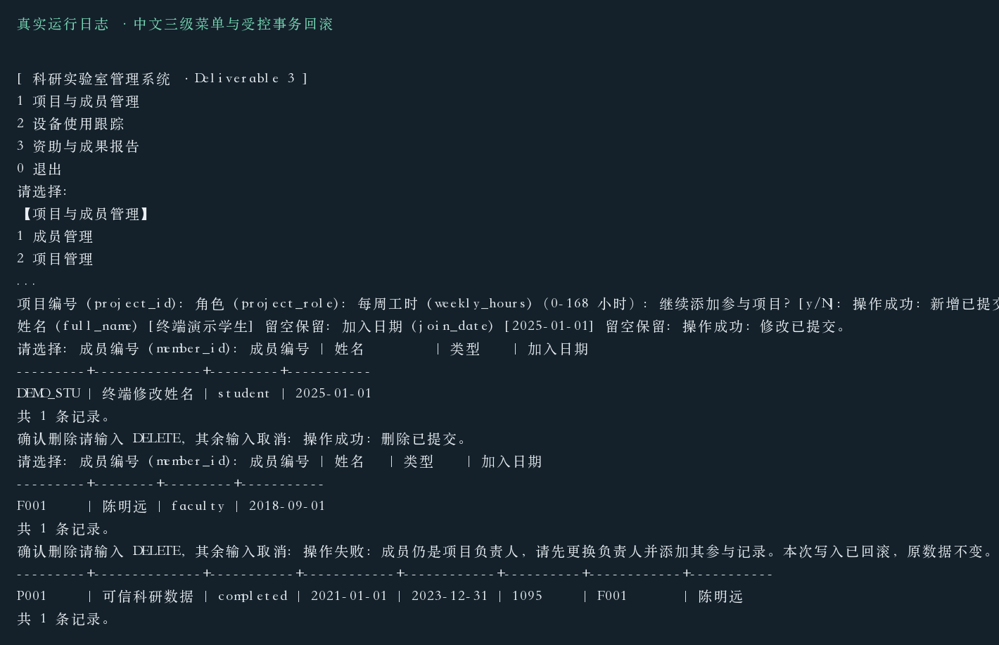
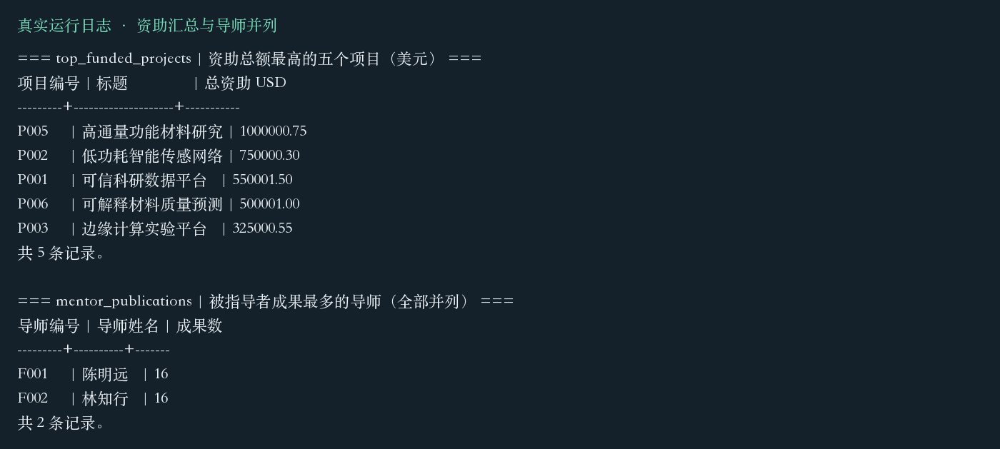

# 科研实验室管理系统 · 第三次小组作业报告

Research Lab Manager · Course Project Deliverable 3

数据库课程大作业第三阶段：实例创建、菜单驱动应用、样例数据、查询报表与完整性验证。

基于第一次概念结构设计和第二次实际逻辑结构提交继续实现。报告、程序、SQL、测试及演示证据统一提交。

完成与验证日期：2026-11-11；预算单位：USD；装置使用时间：北京时间。

| 核心交付 | 完成情况 |
| --- | --- |
| 运行程序 | Python 中文三级终端菜单 + PostgreSQL 数据库存储 |
| 沿用模式 | 原 13 张表、13 个主键、14 个 NO ACTION 外键及全部字段 |
| 样例数据 | 384 条元组，13 张表全部非空 |
| 任务覆盖 | 成员/项目/设备/使用 CRUD，全部十项指定状态与统计查询 |
| 验证 | 70 项自动化测试通过，十项报表逐行吻合参考答案 |
| 环境复现 | scripts/bootstrap.sh 一键装依赖、确认或启动 PostgreSQL、初始化并自检 |
| 提交材料 | PDF/DOCX/Markdown 报告、完整源代码、SQL、运行证据和演示指南 |

## 1 本阶段目标与资料依据

前两阶段已分别完成需求分析与 EER 概念结构、EER 到关系模式的转换及建表 SQL。本阶段目标是在已有关系模式上创建可运行数据库实例，填充足以覆盖全部任务的相互一致的数据，再开发实用的菜单驱动应用，支持查询、新增、修改、删除及资助/成果统计，同时把第二阶段留待实现的跨表与时间约束真正落实。

| 来源 | 本阶段使用方式 |
| --- | --- |
| 5/ProjDel3-ResearchLabManager.pdf（第 1–2 页） | 本次唯一任务清单：可运行、样例充足、三个菜单及全部功能；报告须交代结构修订和困难。 |
| 1/ProjDescription-ResearchLabManager.docx | 原始科研实验室需求：成员特化、弱实体装置、参与、资助、成果和指导。 |
| 1/proj_del1_17/概念结构报告及 EER 附图 | 沿用完全且互斥的成员分类、装置复合键、完全参与、独立使用记录等设计。 |
| 3/ProjDel2/逻辑结构设计报告.docx 与 SQL/create_tables.sql | 以实际交付的 13 表和 14 外键为权威，不使用早期草稿中的另一套字段。 |
| 2/ 与 4/ 个人作业 | 属于不同小世界的练习；只作为 SQL 思路参考，不把供应商/课程等练习表引入本系统。 |
| pdf/ 课程课件 | 关系映射、聚集/连接/去重、复杂约束、函数依赖与规范化的概念参考；具体实现以本阶段实际运行验证为准。 |

实现范围涵盖原题三个主菜单全部条目。界面采用命令行而非复杂 GUI，将开发精力用于事务、完整性与统计正确性。附加的资助、成果、作者、装置和参与管理用于保持数据可维护，不改变原需求的小世界。

### 1.1 原题要求逐条对照

下表把 ProjDel3 题目 PDF 的每一条要求对应到程序入口、SQL/代码位置和报告章节，便于按条核对；“辅助”指本组自行增加、题目未强制的功能。

| 原题要求（ProjDel3 PDF） | 程序位置 | 报告章节 |
| --- | --- | --- |
| Phase 3 须说明本阶段目标 | 报告 §1 | §1 |
| 须说明数据库实例的创建 | app.py --init；SQL/01–03 | §3 |
| 须说明应用程序的开发 | research_lab/（db/cli/service/reports） | §4 |
| 须记录相对 Deliverable 2 的关系模式修订 | SQL/02_integrity.sql；预算单位约定 | §2.2 |
| 须记录遇到的困难及解决方案的理由 | 报告 §7 | §7 |
| 程序必须能运行 | scripts/bootstrap.sh；51 项测试 | §3.1、§6.3 |
| 样例数据须足以完成并演示全部任务 | SQL/03_sample_data.sql，384 条元组 | §3.2 |
| 界面须菜单驱动且实用，不必做复杂 GUI | 三级中文终端菜单 research_lab/cli.py | §4.1 |
| 1 成员查询/新增/修改/删除 | 主菜单 1 → 1（含 7/8/9 子类资料） | §4.2 |
| 1 项目查询/新增/修改/删除 | 主菜单 1 → 2（含 6 参与记录） | §4.2 |
| 1 显示某个项目的状态 | 主菜单 1 → 3 project_status | §5.1 |
| 1 显示在某资助所资助项目上工作过的成员 | 主菜单 1 → 4 grant_members | §5.1 |
| 1 显示在同一项目上工作过的成员之间的指导关系 | 主菜单 1 → 5 shared_project_mentorship | §5.1 |
| 2 设备查询/新增/修改/删除 | 主菜单 2 → 1（含 5 具体装置） | §4.2 |
| 2 设备使用记录查询/新增/修改/删除 | 主菜单 2 → 2 | §4.2 |
| 2 显示某台设备的状态 | 主菜单 2 → 3 equipment_status | §5.1 |
| 2 显示当前正在使用某设备的成员及其在做的项目 | 主菜单 2 → 4 equipment_current_users | §5.1 |
| 3 按资助总额排出前五个项目及各自金额，降序 | 主菜单 3 → 1 top_funded_projects | §5.2 |
| 3 找出被指导者合计成果最多的导师 | 主菜单 3 → 2 mentor_publications | §5.3 |
| 3 按专业和发表年份统计学生成果总数 | 主菜单 3 → 3 student_publications_by_major_year | §5.4 |
| 3 给定日期 X，找出 X 之前结束的项目及各自资助数 | 主菜单 3 → 4 ended_projects | §5.5 |
| 3 找出学生成果最多的三个年份 | 主菜单 3 → 5 top_student_years | §5.6 |
| 每表须有足够元组的 SQL 填充脚本 | SQL/03_sample_data.sql（13 表全部非空） | §3.2 |
| 学期末须现场演示 | docs/demo_guide.md（8–10 分钟流程） | §6.3 |
| 辅助：资助/成果/作者/指导/参与维护 | 主菜单 1 → 6–10；2 → 5；3 → 6–8 | §4.2 |

## 2 与前两次提交的连续性及结构修订

### 2.1 原关系模式逐字节保留

SQL/01_create_tables.sql 与第二阶段实际 create_tables.sql 逐字节一致，SHA-256 为 f1c168d32325d206cf912c11581fd338ae71a7dd8c37953fc205a7e55ae32ac8。所有编号仍为 VARCHAR(40)，工时 NUMERIC(8,2)，预算 NUMERIC(18,2)，使用时刻 TIMESTAMP(0) WITHOUT TIME ZONE，发表年月与可空的日分别保存。没有将装置号误改成全局唯一，也没有额外加入成果—项目关系。

| 表名 | 实体/关系 | 主键 | 样例数 |
| --- | --- | --- | --- |
| lab_member | 成员 | member_id | 24 |
| faculty | 教师资料 | member_id | 6 |
| student | 学生资料 | member_id | 14 |
| external_collaborator | 合作者资料 | member_id | 4 |
| research_project | 项目 | project_id | 10 |
| project_participation | 项目参与 | member_id, project_id | 69 |
| research_grant | 资助 | grant_id | 15 |
| equipment | 设备 | equipment_id | 6 |
| device | 具体装置 | equipment_id, device_number | 12 |
| equipment_usage | 设备使用记录 | usage_id | 36 |
| publication | 学术成果 | publication_id | 30 |
| authorship | 成果作者 | member_id, publication_id | 144 |
| mentorship | 指导关系 | mentee_id | 14 |

student.student_number 保留非空且唯一的附加候选键；device、project_participation、authorship 保留复合主键。14 个外键仍采用默认 NO ACTION；应用删除时按依赖顺序显式处理，不把外键改成自动级联。全部字段及行内 CHECK 见随包 SQL/01_create_tables.sql。

### 2.2 本阶段修订清单与理由

| 事项 | 本次处理 | 理由 |
| --- | --- | --- |
| 预算计量单位 | 第二阶段人民币约定改为本题要求的 USD；数值列不变 | D3 明确 Budget 为美元金额；新样例全部以 USD 输入，未声称对旧金额进行汇率转换。 |
| 跨表完全参与/特化 | 新增延迟约束触发器和 lab_assert_integrity() | 允许先建主实体再建关系，但操作/提交结束时必须一致；单靠外键只能检查已有引用。 |
| 使用时间/人数/状态 | 新增录入验证、非空区间人数检查及状态同步 | 实现第二阶段已声明的规则，避免第四人登记和状态矛盾。 |
| 写入协调 | READ COMMITTED + 统一事务 advisory lock，装置行锁 | 小型实验室写入串行化，防止不同事务分别检查后产生写偏斜。 |
| TRUNCATE 防护 | 13 表增加 BEFORE TRUNCATE 拒绝触发器 | TRUNCATE 不触发普通行级检查，故禁止通过清空关系表留下无作者成果。 |
| 性能辅助 | 六个外键/时间查询索引 | 提高项目、作者、指导者及使用区间查询效率；不改变关系结构或业务语义。 |
| 当前项目口径 | 当前设备用户只关联 status=active 的参与项目 | 不把已完成和暂停项目展示成正在工作；没有 active 项目的使用者仍保留。 |

未修订的假设包括：每名成员至少参加一个项目；负责人必须参加其项目；设备至少有一台装置；成果至少有一名实验室作者；每名被指导者最多保留一段指导记录（mentee_id 主键，结束后也不新存下一段）；不自我指导、学生不指导教师；DOI 可空且不强制唯一。成员在一个项目中仅有一条保存的参与记录，未新增完整工作经历流水。

### 2.3 课程规范化思想的应用边界

依照课程关系模型/函数依赖的思路，角色和工时依赖于成员—项目组合，留在 project_participation；装置属性依赖于设备—装置组合；三类成员专有信息分别保存，避免无关空值。金额汇总和使用时长为查询派生值，不重复保存。这里没有未经证明就宣称任意分解均为 BCNF、无损且保持所有依赖；本阶段继承已提交模式，重点实现其完整性。设备状态是需求要求保存的管理状态，因此由使用记录触发同步，以控制冗余不一致。

## 3 数据库实例创建与样例规划

### 3.1 环境、连接和创建顺序

实际验证环境为 Python 3.13.18、PostgreSQL 18.6 (Homebrew)、psycopg 3，操作系统 macOS。连接可通过 LAB_DSN 或标准 PGHOST/PGPORT/PGUSER 等环境变量配置。默认复用本机 postgres 数据库，在 research_lab_del3 专用 schema 内创建业务实例，不使用或覆盖 public 中的业务表。其他机器可以先 createdb research_lab，再指定 LAB_DSN=dbname=research_lab。

```text
# 推荐：一键准备（幂等；不覆盖已有 schema）
sh scripts/bootstrap.sh          # 建 .venv + 装依赖 + 起 PostgreSQL + --init + 自检
sh scripts/bootstrap.sh --check  # 只自检

# 手工方式
uv venv --python 3.13 .venv      # python3 -m venv .venv 亦可，但见下方说明
.venv/bin/python -m pip install -r requirements.txt
# Optional: createdb research_lab
# export LAB_DSN="dbname=research_lab"
.venv/bin/python app.py --init
.venv/bin/python app.py
.venv/bin/python app.py --demo
```

不要把“机器上有 python3”当成“能建虚拟环境”。本次复现就遇到 Homebrew Python 存在、但 pip 依赖的 libexpat 缺少符号而无法执行 python3 -m venv 的情况；bootstrap.sh 因此先在临时目录实测每个候选解释器的 venv 能力，全部失败时自动退回 uv venv --python 3.13，再安装 requirements.txt 与 requirements-docs.txt。PostgreSQL 未在监听时脚本会尝试用 Homebrew 启动服务并等待就绪；仍失败则明确报错而不是静默继续。

初始化在一个事务内依次创建不存在的 schema、执行原建表 SQL、执行新增完整性 SQL、导入样例、调用完整性检查并立即检查延迟约束后提交。任一步失败则整个创建回滚。初始化不支持覆盖；已有同名 schema 会拒绝，想创建新实例只能显式选新 schema 名称。运行实例只需要查询与写权限；初次初始化与测试还需要创建 schema/函数/触发器的权限。

### 3.2 样例分布与功能覆盖

样例由每表显式 INSERT 构成，总计 384 条元组。24 名成员包含 6 名教师、14 名学生、4 名合作者；10 个项目包含完成、活跃和暂停状态，P009/P010 没有资助。15 项资助包含一项目多资助及相同金额资助，考查求和不应按金额去重。6 种设备各有两台装置，多个设备共用 device01/device02 局部编号，体现复合键。

30 项成果覆盖 2021–2026 年和四个专业，含同专业学生合著、跨专业合著、非学生成果，以及两位导师成果并列。36 条使用包含 27 条已结束历史和 9 条未结束记录；开放记录以导入事务的上海当前时刻减去若干小时生成，重新导入时仍是过去的实际使用，历史日期不依赖未来时间。退役装置的历史先在 available 状态下录入，然后退役，符合不向退役装置新增记录的规则。

所有人员、机构、项目及成果均为虚构教学数据。手册字段保存示例位置，不表示附带真实仪器 PDF。独立参考答案 evidence/sample_reference.json 给出表数量、完整查询行和共同作者去重见证；运行结果 evidence/verification.json 与其逐行比较，不用被测查询计算自身的预期。

## 4 应用程序设计与三个菜单

### 4.1 模块与操作流程

```text
app.py
  -> research_lab/db.py       connection / initialization
  -> research_lab/cli.py      three-level terminal menus
  -> research_lab/service.py  atomic CRUD and dependency handling
  -> research_lab/reports.py  ten parameterized read-only reports
  -> PostgreSQL              original tables + integrity triggers
tests/ -> isolated fresh schemas -> rollback / owned-schema cleanup
```

入口支持 --init、--demo、--dsn 和 --schema。菜单输入编号选择；CRUD 子菜单固定为查询、新增、修改、删除、返回，查询可全表或关键词。类型化输入处理日期、秒精度时间、整数与有限 Decimal；文本 ID 不转整数。修改留空保留旧值，可空字段输入 NULL 清除。结果表格按当前终端宽度自适应：短 ASCII 值（时间戳、collaborator 等枚举）视为不可折断的整体，宽度不足时先折表头，再退化为逐字段竖排，任何情况下都不静默截断内容。交互终端下长结果自动分页（回车继续、q 回车跳过），重定向到文件或管道时不分页，因此 --demo、测试和 evidence 日志始终完整；演示终端建议不窄于 100 列。

| 菜单位置 | 原题/辅助功能 | 程序落点 |
| --- | --- | --- |
| 1 → 1/2 | 成员/项目查询、新增、修改、删除 | LabService + 原表；实体及必需关系一事务 |
| 1 → 3 | 项目状态 | project_status(project_id) |
| 1 → 4 | 给定资助所属项目的工作成员 | grant_members(grant_id) |
| 1 → 5 | 共同项目上的指导关系 | shared_project_mentorship() |
| 1 → 6–10 | 参与、教师/学生/合作者资料、指导维护 | 对应关系与子类 CRUD |
| 2 → 1/2 | 设备/使用记录查询、新增、修改、删除 | LabService + 使用验证/状态同步 |
| 2 → 3 | 设备装置状态及分类计数 | equipment_status(equipment_id) |
| 2 → 4 | 当前使用者及其进行中项目 | equipment_current_users(equipment_id) |
| 2 → 5 | 具体装置维护 | device 复合主键 CRUD |
| 3 → 1–5 | 原题全部五项资助/成果统计 | 五个聚集报表 |
| 3 → 6–8 | 资助、成果及作者维护 | research_grant / publication / authorship |

### 4.2 组合新增、修改和删除

新增成员同时录入超类、相符子类和参与项目，不能只留一个无子类/无项目的成员；新增项目自动添加负责人参与，新增设备同时添加首台装置，新增成果同时添加至少一位作者。项目负责人改变前，应先添加新教师的参与记录；更新状态为 completed 时需同时给出结束日期。固定主键不允许直接改动，以避免隐式迁移依赖关系。

删除先显示对象并要求 DELETE 确认。删除成员时清理其指导、使用、作者、参与与子类，但仍是负责人则拒绝；删除项目清理其资助和参与；删除设备清理其使用和装置；删除成果清理作者关系。所有步骤均在事务内，若使其他成员失去最后一个项目、成果失去最后作者、设备失去最后装置或负责人失去参与记录，则全部回滚。不是绕过 NO ACTION 外键，而是在受控事务中按外键顺序显式删除。

### 4.3 参数、安全和错误反馈

用户值通过 psycopg 占位符绑定，表/字段名由白名单和 sql.Identifier 构造，不拼接输入。输入 SQL 片段只作为普通搜索文本或编号，不能扩展查询。数据库错误展示主要原因并回滚，不让终端因单次失败中止；EOF/Ctrl+C 安全退出，未提交操作不保存。DSN 可外部配置，不把密码写进代码或提交材料。

### 4.4 课堂演示网页（与终端同源）

终端表格在投影上读起来吃力，因此本阶段另加一个本机演示网页：python app.py --web 用标准库在 127.0.0.1 起 JSON API 与静态单页，不引入 Web 框架。网页不复制业务规则——写操作调用与终端相同的 LabService，十项报表调用相同的 run_report，因此回滚、依赖保护和统计口径天然一致；删除在网页上同样要求输入 DELETE。前端为原生 JS 三件套，无框架、无 CDN，断网可用；模式卡片与外键关系图、报表参数控件、完整性说明和验证数字均由 /api/meta 从真实数据库与 evidence/verification.json 生成。

| 端点 / 页面 | 终端对应 | 说明 |
| --- | --- | --- |
| GET / 与 web/ 三件套 | python app.py 终端菜单 | 同一 LabService / run_report；编辑感极简版式 |
| GET /api/meta | — | 13 表字段与键、14 外键、各表计数、验证摘要，供模式图与统计条 |
| GET /api/rows 与 /api/record | 各表 1 查询 | 关键词查询与单条读取 |
| POST /api/rows | 各表 2 新增 | 成员/项目/设备/成果组合新增，一个事务 |
| PATCH /api/record | 各表 3 修改 | 留空保留、NULL 清除，与终端一致 |
| DELETE /api/record | 各表 4 删除 | 依赖保护与整体回滚；网页同样需输入 DELETE |
| GET /api/report | 1→3/4/5、2→3/4、3→1–5 | 十项报表，参数下拉与日期控件，附口径与真实 SQL |

网页只监听回环地址、不含登录与权限，定位为课堂演示而非生产服务；tests/test_web.py 用随机 schema 与 ephemeral 端口起真服务，覆盖元数据、静态页与路径穿越防护、查询、十项报表逐行一致、组合新增、违规整体回滚与受保护删除。



## 5 指定查询、统计口径与实际结果

### 5.1 项目与设备查询

project_status 查询编号、负责人及实际状态。grant_members 从一项资助的 project_id 连接项目参与和成员，不把同项目多项资助连接成重复成员。shared_project_mentorship 同时连接两端参与记录，要求相同 project_id；一对成员共享多项目时逐项目展示，含已经保存的历史指导。按资助与共同项目查询限于原表尚保存的参与关系，无法推断被删掉的历史经历。

equipment_status 的状态属于 device，而不杜撰 equipment.status：返回装置数量、available/in_use/retired 分类计数及每台装置明细。当前使用按左闭右开时间包含查询时刻判断，结合实际使用不能未来的约束，当前占用来自 ended_at=NULL 的记录。用户项目按 status=active 解释为正在工作的项目；先筛活跃参与再左连接，避免多个已完成参与产生重复 NULL 行，也不会漏掉没有活跃项目的当前用户。

| 示例 | 实测结果 |
| --- | --- |
| P001 状态 | completed；2021-01-01 开始、2023-12-31 结束，负责人 F001 陈明远 |
| G001 成员 | 9 人，包括教师、学生和合作者 |
| 共同项目指导 | 40 条导师—被指导者—项目记录 |
| E001 状态 | 2 台装置均 in_use；device01 三人，device02 一人 |
| E001 当前用户与项目 | F001→P007；S001→P006/P007；S002→P007；S004→NULL，共 4 人、5 行 |

### 5.2 项目资助 Top5

只连接项目和资助，按项目编号/标题分组，用 SUM(budget) 汇总而非 SUM(DISTINCT budget)，相同金额的两笔资助必须分别计算。LEFT JOIN 保留零资助项目，COALESCE 将空和转 0。总额降序、项目编号升序排序，最多五项，不因第五名并列扩展。

| 项目编号 | 项目 | 总资助 USD |
| --- | --- | --- |
| P005 | 高通量功能材料研究 | 1000000.75 |
| P002 | 低功耗智能传感网络 | 750000.30 |
| P001 | 可信科研数据平台 | 550001.50 |
| P006 | 可解释材料质量预测 | 500001.00 |
| P003 | 边缘计算实验平台 | 325000.55 |

### 5.3 被指导者成果最多的导师

对 mentorship 中实际出现的导师，连接所有被指导者的 authorship，按导师 COUNT(DISTINCT publication_id) 求成果集合大小；指导者不限教师，被指导者不限学生，统计全部保存成果，不额外按指导时间切截。外连接保留零成果导师，再选等于最大值的所有导师。F001 的多个被指导者合著不能简单相加。

| 导师编号 | 姓名 | 不同成果数 |
| --- | --- | --- |
| F001 | 陈明远 | 16 |
| F002 | 林知行 | 16 |

实测 F001 和 F002 全并列返回，各 16 项。附加边界测试清空全部成果（通过受控 DELETE）后，六位实际导师以 0 项全并列返回。

### 5.4 按专业与发表年份统计学生成果

连接 student、authorship、publication，按 major/publication_year 分组，对 publication_id 去重。同专业多个学生合著在该分组只计一次；跨专业成果在每个相关专业分别计一次，所以不同专业数量之和可能超过该年的全局学生成果数。没有成果的专业/年份不凭空补零年份。

| 专业 | 2021 | 2022 | 2023 | 2024 | 2025 | 2026 |
| --- | --- | --- | --- | --- | --- | --- |
| 材料科学 | 0 | 2 | 3 | 4 | 3 | 2 |
| 生物工程 | 0 | 2 | 2 | 2 | 3 | 1 |
| 电子工程 | 2 | 3 | 3 | 5 | 4 | 3 |
| 计算机科学 | 2 | 2 | 4 | 3 | 4 | 3 |

表格为便于阅读将未出现的专业/年份位置展示为 0；实际查询输出 22 个非空分组，完整行在运行证据中。统计的是成果数量，不是学生数或作者关系数。

### 5.5 日期之前结束的项目及资助数量

使用 end_date < X，严格早于，不使用 <=；NULL 结束日期自然排除。项目左连接资助，COUNT(grant_id) 而非 COUNT(*)，使零资助仍为 0。这里按结束日期判定，不额外要求 status=completed，以忠实对应题目的日期条件。

| 项目 | 结束日期 | 资助数 |
| --- | --- | --- |
| P009 | 2022-12-31 | 0 |
| P001 | 2023-12-31 | 3 |
| P002 | 2024-06-30 | 2 |
| P003 | 2024-12-31 | 2 |

示例 X=2025-01-01；P004 恰好在该日结束，因此不包含；P009 完全无资助仍正确返回 0。

### 5.6 学生成果最丰富的三个年份

在所有学生作者之间按年份全局去重成果，不能把各专业分组相加，也不计入仅有非学生作者的成果。按成果数降序、年份降序稳定排序，最多三年。附加相同产量年份测试保证不把第三名并列全部扩展。

| 年份 | 不同学生成果数 |
| --- | --- |
| 2025 | 7 |
| 2024 | 6 |
| 2023 | 5 |



## 6 完整性、事务与验证证据

### 6.1 完全参与及跨表一致性

原主键、外键、唯一、非空和 CHECK 继续检查引用与行内域约束；新增 lab_assert_integrity() 检查匹配且恰好一个子类、成员至少一项目、负责人参与、设备至少一装置、成果至少一作者、学生不能指导教师。业务事务结束时主动检查，数据库 DEFERRABLE INITIALLY DEFERRED 约束触发器在提交前也检查，覆盖直接 SQL 的 INSERT/UPDATE/DELETE。

### 6.2 使用区间、状态和并发

使用区间为 [started_at, ended_at)，空结束视为正无穷，零长度区间不占用装置。两非空区间重叠当且仅当 s1<e2 且 s2<e1；同一成员同一装置禁止重叠，相邻结束/开始边界允许。人数只可能在非空开始事件增长，所以在各开始时刻 COUNT(DISTINCT member_id)，任意时刻不得超过 3。历史总记录数不受三条上限限制。

录入触发器用 Shanghai clock_timestamp 拒绝未来实际开始/结束；退役装置不接受新使用或重新开启使用。使用新增、修改、删除后，将非退役装置按未结束使用自动同步成 in_use/available；退役前必须无开放使用，退役历史保留。多条使用共同占用时，结束其中一条不会错误地把仍有人用的装置标成 available。

所有写事务在 READ COMMITTED 下取得同一 advisory transaction lock，并对装置取得行锁。锁持有到提交/回滚，下一写事务在前一事务完成后检查最新已提交事实。代价是写入串行化；小型课堂应用选择正确性优先，不宣称具备大规模吞吐能力。TRUNCATE 单独禁止；正式部署还应避免让日常用户持有禁用/删除触发器的管理权限。

### 6.3 自动测试与独立验证

| 验证类别 | 覆盖点 |
| --- | --- |
| 25 项数据库业务测试 | 成员/项目/设备/使用/资助/成果生命周期；缺少关系、负责人、三人上限、重叠、未来、退役、指导、闰日、学号/主键/NaN 等 |
| 7 项真实终端测试 | 三个菜单与统计，成员/项目/设备/使用 CRUD，失败回滚继续操作，只读演示与 EOF/无效选项 |
| 1 项双连接并发测试 | 两人已占用，第三人持锁，第四人在独立会话等待；第三人提交后第四人以 23514 拒绝 |
| 18 项报表与结构测试 | 十项逐行参考比对、数据计数、13 PK/14 FK、全零导师、相同金额、合著/并列年度、参数绑定、active 过滤、TRUNCATE 防护 |
| 独立 SQL 与演示 | psql 执行 SQL/04_report_queries.sql；真实终端 3 次成功变更 + 1 次预期拒绝；结果与日志保存 |

最新真实结果：70 项唯一测试通过，退出码 0；十项报表全部逐行匹配独立参考，SQL 文件执行和终端演示均退出码 0。总样例数 384，13 张表计数全部吻合。测试每轮创建随机 schema，只删除本轮自己创建的对象，每个普通测试回滚业务修改；不复用或清空既有业务实例。

```text
sh scripts/bootstrap.sh --check
python -m unittest discover -s tests -v
python docs/verify_submission.py

Evidence:
  evidence/unittest.log
  evidence/verification.json
  evidence/standalone_sql.log
  evidence/demo_reports.txt
  evidence/menu_demo.txt
  evidence/sample_reference.json
```

## 7 开发困难、处理理由与局限

| 问题 | 解决及理由 |
| --- | --- |
| 原提交与草稿模式不同 | 重新核对实际压缩包、DOCX 和 SQL，保留 13 表/文本 ID/弱实体复合键；用字节哈希和实际约束数量验证连续性。 |
| 新增主实体时必需关系暂时未建 | 使用组合业务事务和延迟检查，只对最终一致状态提交，避免提前检查导致合法新增不可执行。 |
| 删除涉及多级依赖 | 显式处理依赖并最终完整性检查；拒绝破坏其他对象，测试确认失败后数据整组恢复。 |
| 日期精度、未来输入和零长度区间 | 统一北京时间秒精度；相邻边界与空区间单独测试，不用历史记录总数替代同时人数。 |
| 多连接同时检查都看到空余 | 增加全局写事务锁，真实双连接测试观测等待并验证第四人提交失败，而非仅顺序单连接试验。 |
| 多对多连接会夸大金额/成果 | 金额只连接项目和资助；成果按 publication_id DISTINCT；金额本身不能 DISTINCT，以免漏掉同金额资助。 |
| 当前工作项目与保存的全部参与不同 | 先筛 active 项目再左连接当前使用者，已完成/暂停排除，但没有 active 项目的使用者保留 NULL。 |
| TRUNCATE 绕过普通行触发器 | 定向复现后新增拒绝触发器，补回归用例；管理员改变触发器仍是权限边界。 |
| 临时 Python 环境依赖不可见 | 定位旧临时环境缺失 pyvenv.cfg，重新创建独立环境再安装依赖；所有最终结果来自修复后的实际运行。 |
| 中文文档显示 | 统一 Markdown/DOCX/PDF 内容源，PDF 嵌入中文字体，结合提取文字和页面渲染检查。 |
| 交付环境在复现时整体失效 | PostgreSQL 与 Python 3.13 都已不在机器上，且 Homebrew python3 的 pip 因 libexpat 符号缺失无法建 venv；重装 PostgreSQL 18.6 并用 uv 重建 3.13.18 环境后重跑全部验证，另加 scripts/bootstrap.sh 把“挑解释器—装依赖—起库—初始化—自检”固化为一条命令。 |
| 宽报表在终端上刷屏 | 同项目指导关系有 40 行 8 列，原先一律竖排成三百多行，课堂演示无法阅读；改为按终端宽度自适应，优先保证数据列不被折断、其次折表头、最后才竖排，并在交互终端分页。40 行报表由约 360 行降到约 50 行。 |
| 字段标签混入输入提示 | TABLES 的字段说明原先把提示写进标签，查询表头出现“类型 faculty/student/collaborator”“每周工时 0-168”；改为 标签/类型/提示 三段结构，表头只显示标签，提示只在录入时出现。 |
| 文档依赖只靠传递安装 | build_report.py 与 verify_documents.py 直接 import PIL，却未写进 requirements-docs.txt，仅因 reportlab 恰好带上 Pillow 才能跑；已显式声明 pillow，避免换版本后文档管线突然失败。 |
| 终端表格投影可读性差 | 新增本机演示网页：业务层与终端同源，模式图、参数化报表、完整性与验证一页呈现；用真实浏览器走完新增/删除全链路并截图核对版式后才收进提交包。 |

本次没有增加完整参与起止历史；按资助查成员及同项目指导只反映保存的参与集合。导师统计按题意取保存的全部被指导者成果，不声称只统计指导期间因果贡献。应用不包含登录、财务换汇、审计恢复和复杂 GUI，正式多实验室环境需重新设计权限与锁粒度。本次提交可支持现场演示，但期末预约和现场展示仍需小组按课程通知完成，程序不会自动代预约。

## 8 结论与课程参考

本阶段将原概念与逻辑模式落为真实 PostgreSQL 实例及可运行菜单应用，提供所有原题 CRUD 和十项查询，通过关系、时间、并发和报表边界验证。结构修订限于预算约定、完整性机制及索引，原表/键/字段保持一致。随包 README 和演示指南给出复现方法，PDF/DOCX 报告、样例 SQL、源程序及真实证据构成第三次小组作业提交。

课程引用均为用户提供的本地课件，不引用外部答案：07-ERtoRelational.pdf（超类/子类、弱实体、联系映射）；08-09(3)-SQLComplexQueries-AdvancedIssues-full.pdf 第 27 页（COUNT DISTINCT）及聚集分组/外连接章节；08-09(4)-SQL-Constraints-Plus-Landscape.pdf 第 3–5 页（完全参与、复杂约束与 EXISTS/NOT EXISTS 断言思想）；100(1)-FDs-Landscape.pdf 与 100(2)-NFs.pdf 第 7–12 页（依赖及规范化）；110-SchemaDecomposition - landscape.pdf 第 4–6 页（无损连接和保持依赖的区别）。页码为 PDF 实际页序。

课件的数据库全局断言思想在此实现为 PostgreSQL 延迟触发器与显式检查，而非提交仅能书写、未验证可运行的标准断言。功能与边界的判断以本包实际运行结果为证据。

## 附录 A 全部十项报表 SQL

以下 SQL 与实际程序同源，参数以 %s 表示，执行时由 psycopg 单独绑定。需要在 psql 运行的安全变量版本见 SQL/04_report_queries.sql。建表、约束和各表填充脚本见 SQL/01–03，不在正文重复展开。

### A.1 项目状态（project_status）

参数：project_id。

```sql
SELECT p.project_id,
       p.title,
       p.status,
       p.start_date,
       p.end_date,
       p.planned_duration_days,
       p.leader_id,
       leader.full_name AS leader_name
FROM research_project AS p
JOIN lab_member AS leader ON leader.member_id = p.leader_id
WHERE p.project_id = %s;
```

### A.2 指定资助项目的参与成员（grant_members）

参数：grant_id。

```sql
SELECT g.grant_id,
       p.project_id,
       p.title,
       m.member_id,
       m.full_name,
       m.member_type,
       pp.project_role,
       pp.weekly_hours
FROM research_grant AS g
JOIN research_project AS p ON p.project_id = g.project_id
JOIN project_participation AS pp ON pp.project_id = p.project_id
JOIN lab_member AS m ON m.member_id = pp.member_id
WHERE g.grant_id = %s
ORDER BY p.project_id, m.member_id;
```

### A.3 同项目成员的指导关系（含历史记录）（shared_project_mentorship）

参数：无。

```sql
SELECT ms.mentor_id,
       mentor.full_name AS mentor_name,
       ms.mentee_id,
       mentee.full_name AS mentee_name,
       p.project_id,
       p.title,
       ms.start_date AS mentorship_start_date,
       ms.end_date AS mentorship_end_date
FROM mentorship AS ms
JOIN lab_member AS mentor ON mentor.member_id = ms.mentor_id
JOIN lab_member AS mentee ON mentee.member_id = ms.mentee_id
JOIN project_participation AS mentor_pp
  ON mentor_pp.member_id = ms.mentor_id
JOIN project_participation AS mentee_pp
  ON mentee_pp.member_id = ms.mentee_id
 AND mentee_pp.project_id = mentor_pp.project_id
JOIN research_project AS p ON p.project_id = mentor_pp.project_id
ORDER BY ms.mentor_id, ms.mentee_id, p.project_id;
```

### A.4 设备的装置状态明细与汇总（equipment_status）

参数：equipment_id。

```sql
SELECT e.equipment_id,
       e.equipment_name,
       e.equipment_type,
       e.manual_location,
       COUNT(d.device_number) AS device_count,
       COUNT(d.device_number) FILTER (WHERE d.status = 'available')
           AS available_device_count,
       COUNT(d.device_number) FILTER (WHERE d.status = 'in_use')
           AS in_use_device_count,
       COUNT(d.device_number) FILTER (WHERE d.status = 'retired')
           AS retired_device_count,
       COALESCE(
           jsonb_agg(
               jsonb_build_object(
                   'device_number', d.device_number,
                   'purchase_date', d.purchase_date,
                   'status', d.status
               ) ORDER BY d.device_number
           ) FILTER (WHERE d.device_number IS NOT NULL),
           '[]'::jsonb
       ) AS devices
FROM equipment AS e
LEFT JOIN device AS d ON d.equipment_id = e.equipment_id
WHERE e.equipment_id = %s
GROUP BY e.equipment_id, e.equipment_name,
         e.equipment_type, e.manual_location;
```

### A.5 设备当前使用成员及其进行中项目（equipment_current_users）

参数：equipment_id。

```sql
WITH current_usage AS (
    SELECT DISTINCT u.equipment_id, u.device_number, u.member_id
    FROM equipment_usage AS u
    WHERE u.equipment_id = %s
      AND u.started_at <= (statement_timestamp() AT TIME ZONE 'Asia/Shanghai')
      AND (u.ended_at IS NULL OR
           u.ended_at > (statement_timestamp() AT TIME ZONE 'Asia/Shanghai'))
), current_projects AS (
    SELECT pp.member_id, p.project_id, p.title
    FROM project_participation AS pp
    JOIN research_project AS p ON p.project_id = pp.project_id
    WHERE p.status = 'active'
)
SELECT cu.equipment_id,
       e.equipment_name,
       cu.device_number,
       m.member_id,
       m.full_name,
       p.project_id,
       p.title
FROM current_usage AS cu
JOIN equipment AS e ON e.equipment_id = cu.equipment_id
JOIN lab_member AS m ON m.member_id = cu.member_id
LEFT JOIN current_projects AS p ON p.member_id = m.member_id
ORDER BY cu.equipment_id, cu.device_number, m.member_id, p.project_id;
```

### A.6 资助总额最高的五个项目（美元）（top_funded_projects）

参数：无。

```sql
SELECT p.project_id,
       p.title,
       COALESCE(SUM(g.budget), 0) AS total_funding_usd
FROM research_project AS p
LEFT JOIN research_grant AS g ON g.project_id = p.project_id
GROUP BY p.project_id, p.title
ORDER BY total_funding_usd DESC, p.project_id ASC
LIMIT 5;
```

### A.7 被指导者成果最多的导师（全部并列）（mentor_publications）

参数：无。

```sql
WITH mentor_totals AS (
    SELECT ms.mentor_id,
           mentor.full_name AS mentor_name,
           COUNT(DISTINCT a.publication_id) AS publication_count
    FROM mentorship AS ms
    JOIN lab_member AS mentor ON mentor.member_id = ms.mentor_id
    LEFT JOIN authorship AS a ON a.member_id = ms.mentee_id
    GROUP BY ms.mentor_id, mentor.full_name
)
SELECT mentor_id, mentor_name, publication_count
FROM mentor_totals
WHERE publication_count = (
    SELECT MAX(publication_count) FROM mentor_totals
)
ORDER BY mentor_id;
```

### A.8 按专业及发表年份统计学生成果（student_publications_by_major_year）

参数：无。

```sql
SELECT s.major,
       p.publication_year,
       COUNT(DISTINCT p.publication_id) AS publication_count
FROM student AS s
JOIN authorship AS a ON a.member_id = s.member_id
JOIN publication AS p ON p.publication_id = a.publication_id
GROUP BY s.major, p.publication_year
ORDER BY s.major, p.publication_year;
```

### A.9 指定日期之前结束的项目及资助数量（ended_projects）

参数：end_before。

```sql
SELECT p.project_id,
       p.title,
       p.end_date,
       COUNT(g.grant_id) AS grant_count
FROM research_project AS p
LEFT JOIN research_grant AS g ON g.project_id = p.project_id
WHERE p.end_date < %s::date
GROUP BY p.project_id, p.title, p.end_date
ORDER BY p.end_date, p.project_id;
```

### A.10 学生成果最多的三个年份（top_student_years）

参数：无。

```sql
SELECT p.publication_year,
       COUNT(DISTINCT p.publication_id) AS publication_count
FROM publication AS p
JOIN authorship AS a ON a.publication_id = p.publication_id
JOIN student AS s ON s.member_id = a.member_id
GROUP BY p.publication_year
ORDER BY publication_count DESC, p.publication_year DESC
LIMIT 3;
```
